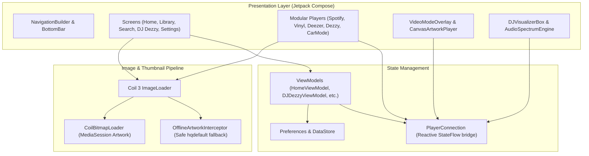
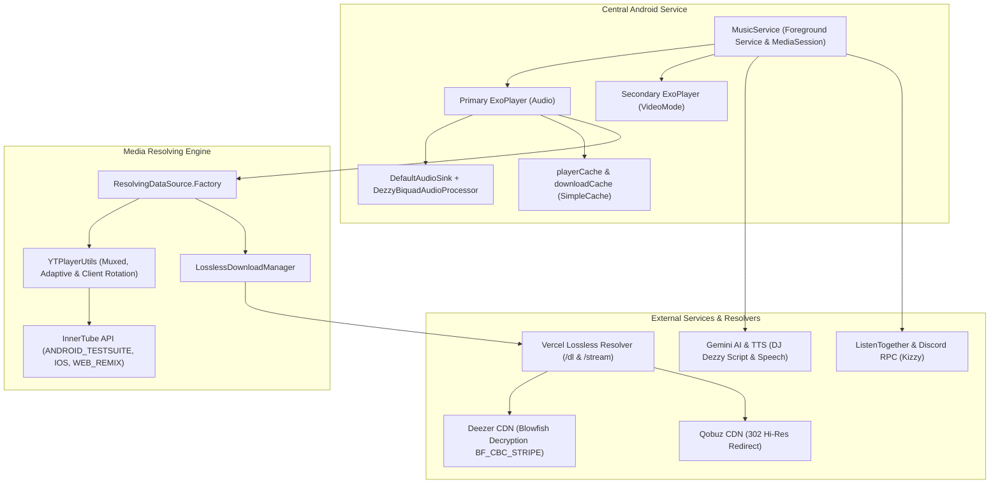
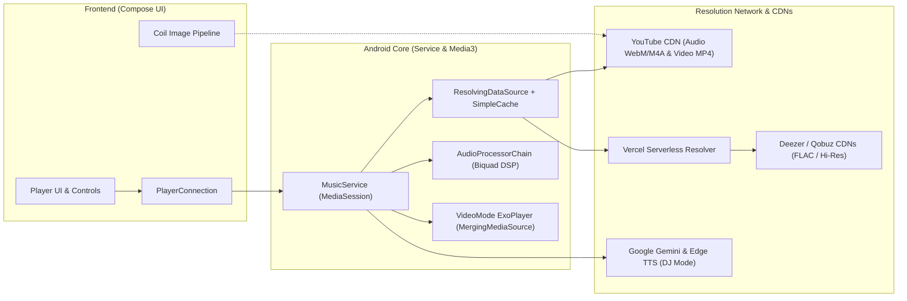

# Dezzy

<div align="center">
  
  
  ### Advanced YouTube Music Client with Material Design 3 for Android
  
  [](https://github.com/dezzy-music/Dezzy/releases)
  [](https://github.com/dezzy-music/Dezzy/blob/main/LICENSE)
  [](https://crowdin.com/project/dezzymusic)
  [](https://www.android.com)
  [](https://github.com/dezzy-music/Dezzy/stargazers)
  [](https://github.com/dezzy-music/Dezzy/network/members)
</div>

---

## Table of Contents

- [Overview](#overview)
- [Technology Stack](#technology-stack)
- [System Architecture](#system-architecture)
  - [1. Frontend Architecture (UI & Presentation)](#1-frontend-architecture-ui--presentation)
  - [2. Backend & Services Architecture (Core Playback & Resolvers)](#2-backend--services-architecture-core-playback--resolvers)
  - [3. Combined End-to-End Architecture](#3-combined-end-to-end-architecture)
- [Key Features](#key-features)
- [Documentation](#documentation)
- [Installation](#installation)
- [Building from Source](#building-from-source)
- [Contributing](#contributing)
- [Support the Project](#support-the-project)
- [Acknowledgments](#acknowledgments)
- [License](#license)

---

## Overview

**Dezzy** is an open-source YouTube Music client specifically designed for Android devices. It delivers a superior user experience with a modern interface implementing Material Design 3, offering advanced functionalities to explore, play, and manage musical content without the limitations of the official application.

### Key Benefits

- **Ad-free Experience**: Enjoy uninterrupted music streaming
- **Enhanced Performance**: Optimized for smooth playback and navigation
- **Privacy-focused**: No data collection or tracking
- **Customizable Interface**: Personalize your music experience
- **Offline Capabilities**: Download and play music without internet connection

> **Note**: Dezzy is an independent project and is not affiliated, sponsored, or endorsed by YouTube or Google.

---

## Technology Stack

<div align="center">
  
| Frontend | Backend | Development Tools |
|:--------:|:-------:|:----------------:|
|  |  |  |
|  |  |  |
|  | |  |

</div>

---

## System Architecture

Dezzy is organized into decoupled, reactive modules, linking a modern Jetpack Compose UI with a low-latency playback engine based on AndroidX Media3 and distributed media resolution services.

### 1. Frontend Architecture (UI & Presentation)



### 2. Backend & Services Architecture (Core Playback & Resolvers)



### 3. Combined End-to-End Architecture



---

## Main Features

**Dezzy** doesn't just inherit the robustness of a complete client, but has been redesigned with massive and exclusive integrations to offer the ultimate experience:

### 🌟 User Experience and Customization (Exclusive)
<table>
<tr>
<th width="30%">Feature</th>
<th width="70%">Description</th>
</tr>
<tr>
<td><strong>🎨 Platform Imitation</strong></td>
<td>We've managed to accurately recreate the player styles and UI of the most popular streaming platforms. Feel like you're using your favorite app but with all the power of Dezzy!</td>
</tr>
<tr>
<td><strong>🎬 Canvas System (Video Backgrounds)</strong></td>
<td>Enjoy looping short videos (Spotify Canvas style) playing in the background of your favorite tracks for an unparalleled immersive experience.</td>
</tr>
<tr>
<td><strong>✨ Dynamic Themes Pro</strong></td>
<td>The interface doesn't just adapt to album cover colors, it completely redefines its palette using advanced Material Design 3 algorithms.</td>
</tr>
<tr>
<td><strong>🌐 Multi-language Support</strong></td>
<td>Available in numerous languages for global users.</td>
</tr>
<tr>
<td><strong>🚗 Android Auto Compatible</strong></td>
<td>Full integration with vehicle infotainment systems.</td>
</tr>
<tr>
<td><strong>🖼️ Artwork Export</strong></td>
<td>Save high-resolution album images directly to your device.</td>
</tr>
</table>

### 🎵 Hi-Fi Audio and Downloads (Exclusive)
<table>
<tr>
<th width="30%">Feature</th>
<th width="70%">Description</th>
</tr>
<tr>
<td><strong>💎 Lossless FLAC Audio</strong></td>
<td>Native integration for playing FLAC (Lossless) files. Listen to your music with maximum fidelity and original studio quality.</td>
</tr>
<tr>
<td><strong>📥 Advanced Direct Download</strong></td>
<td>Ultra-fast direct download system built into the core to save all your music and enjoy it offline instantly.</td>
</tr>
<tr>
<td><strong>🔊 Custom Audio Engine</strong></td>
<td>Volume normalization, tempo/pitch control, and smart silence skipping processed directly on your device.</td>
</tr>
</table>

### 🎤 Lyrics and Intelligence (Exclusive)
<table>
<tr>
<th width="30%">Feature</th>
<th width="70%">Description</th>
</tr>
<tr>
<td><strong>🌍 Online Translation without APIs</strong></td>
<td>We've successfully implemented real-time lyrics translation completely online, without relying on paid or external APIs!</td>
</tr>
<tr>
<td><strong>📜 Synchronized Lyrics (LRC)</strong></td>
<td>View the lyrics of your songs perfectly synced word-by-word with the music.</td>
</tr>
</table>

### 🛠️ Enhanced Classic Functionality
<table>
<tr>
<th width="30%">Feature</th>
<th width="70%">Description</th>
</tr>
<tr>
<td><strong>🚫 100% Ad-Free</strong></td>
<td>Enjoy music and browsing without ad interruptions forever.</td>
</tr>
<tr>
<td><strong>🔄 Background Playback</strong></td>
<td>Keep listening while using other apps or with the screen off.</td>
</tr>
<tr>
<td><strong>👤 Account Synchronization</strong></td>
<td>Log in to instantly bring over all your preferences and collections.</td>
</tr>
<tr>
<td><strong>🔍 Advanced Search</strong></td>
<td>Quickly find songs, videos, albums, and playlists.</td>
</tr>
<tr>
<td><strong>📚 Library Management</strong></td>
<td>Organize and fully manage your music collection exactly how you want.</td>
</tr>
</table>

---

## Documentation

For detailed information about configuration, advanced features, and usage guides, consult our official documentation:

<div align="center">
  
[](https://dezzymusic.gitbook.io/)

</div>

---

## Installation

### System Requirements

| Component | Minimum Requirement |
|:----------|:--------------------|
| Operating System | Android 6.0 (Marshmallow) or higher |
| Storage Space | 10 MB available |
| Network | Internet connection for streaming |
| RAM | 2 GB recommended |

### Installation Methods

#### Option 1: GitHub Releases (Recommended)

1. Navigate to the [Releases](https://github.com/dezzy-music/Dezzy/releases) section on GitHub
2. Download the APK file from the latest stable version
3. Enable "Install from unknown sources" in your device's security settings
4. Open the downloaded APK file to complete installation

#### Option 2: Official Website

1. Visit the official [Dezzy website](https://dezzymusic.netlify.app/)
2. Select the download option for Android
3. Follow the installation instructions provided


> **Security Notice**: For security reasons, it is recommended to obtain the application exclusively through the official channels mentioned above. Avoid downloading APKs from unverified sources.

---

## Building from Source

### Prerequisites

<table>
<tr>
<th>Tool</th>
<th>Recommended Version</th>
<th>Purpose</th>
</tr>
<tr>
<td>Gradle</td>
<td>7.5 or higher</td>
<td>Build automation</td>
</tr>
<tr>
<td>Kotlin</td>
<td>1.7 or higher</td>
<td>Programming language</td>
</tr>
<tr>
<td>Android Studio</td>
<td>2022.1 or higher</td>
<td>IDE and development environment</td>
</tr>
<tr>
<td>JDK</td>
<td>11 or higher</td>
<td>Java runtime environment</td>
</tr>
<tr>
<td>Android SDK</td>
<td>API level 33 (Android 13)</td>
<td>Android development tools</td>
</tr>
</table>

### Environment Setup

```bash
# Clone the repository
git clone https://github.com/dezzy-music/Dezzy.git

# Navigate to project directory
cd Dezzy

# Update submodules (if any)
git submodule update --init --recursive
```

### Build Methods

#### Android Studio Build

1. Open Android Studio
2. Select "Open an existing Android Studio project"
3. Navigate and select the Dezzy directory
4. Wait for project synchronization and indexing
5. Select Build → Build Bundle(s) / APK(s) → Build APK(s)

#### Command Line Build

```bash
# Build production release
./gradlew assembleRelease

# Build debug version
./gradlew assembleDebug

# Full build with tests
./gradlew build

# Run unit tests
./gradlew test

# Clean build
./gradlew clean
```

> **Note**: Compiled APK files will be located in the `app/build/outputs/apk/` directory.

---

## Contributing

### Code of Conduct

All participants in this project must adhere to our code of conduct that promotes an inclusive, respectful, and constructive environment. Please review the [complete Code of Conduct](https://github.com/dezzy-music/Dezzy/blob/master/CODE_OF_CONDUCT.md) before contributing.

### Translation

Help translate Dezzy into your language or improve existing translations:

<div align="center">
  
[](https://poeditor.com/join/project/208BwCVazA)
[](https://crowdin.com/project/dezzymusic)

</div>

### Community Channels

<div align="center">
  
[](https://t.me/Dezzy_chat)
[](https://t.me/dezzymusic_updates)

</div>

### Development Workflow

1. **Issue Review**: Check [open issues](https://github.com/dezzy-music/Dezzy/issues) or create a new one describing the problem or feature
2. **Fork Repository**: Create a personal fork of the repository
3. **Feature Branch**: Create a branch for your feature (`git checkout -b feature/new-feature`)
4. **Implementation**: Implement changes following project coding conventions
5. **Testing**: Ensure code passes all tests (`./gradlew test`)
6. **Commit**: Make commits with descriptive messages (`git commit -m 'feat: add new feature'`)
7. **Push Changes**: Upload changes to your fork (`git push origin feature/new-feature`)
8. **Pull Request**: Open a PR detailing changes and referencing corresponding issue

> **Development Guidelines**: Review our [contribution guidelines](https://github.com/dezzy-music/Dezzy/blob/master/CONTRIBUTING.md) for detailed information about development process, code standards, and workflow.

---

## Support the Project

If you find value in **Dezzy** and want to contribute to its continued development, consider making a donation. Your financial support allows us to:

- Implement new features and improvements
- Fix bugs and optimize performance
- Maintain project infrastructure
- Dedicate more time to development and maintenance

<div align="center">
  
[](https://github.com/sponsors/dezzy-music)
[](mailto:dezzyquiet@gmail.com)

</div>

> **Note**: Donations are completely optional. Dezzy will always be free and open-source, regardless of financial support received.

---

## Acknowledgments

Special thanks to the following contributors and supporters:

- **mostafaalagamy** - MetroList implementation
- **Fabito02** - Unconditional support from the beginning
- **Community translators** - Making Dezzy accessible worldwide
- **Beta testers** - Helping improve stability and usability

---

## License

**Copyright © 2025 Dezzy**

This program is free software: you can redistribute it and/or modify it under the terms of the GNU General Public License as published by the Free Software Foundation, either version 3 of the License, or (at your option) any later version.

This program is distributed in the hope that it will be useful, but **WITHOUT ANY WARRANTY**; without even the implied warranty of MERCHANTABILITY or FITNESS FOR A PARTICULAR PURPOSE. See the [GNU General Public License](https://github.com/dezzy-music/Dezzy/blob/main/LICENSE) for more details.

<div align="center">
  
[](https://www.gnu.org/licenses/gpl-3.0)

</div>

> **Important**: Any unauthorized commercial use of this software or its derivatives constitutes a violation of the license terms.

---

<div align="center">
  <p><strong>© 2023-2024 Open Source Projects</strong></p>
  <p>Developed with passion by <a href="https://github.com/dezzy-music">Dezzy</a></p>
  
  <br>
  
  [](https://github.com/dezzy-music)
  [](mailto:contacto@dezzymusic.com)
  
</div>
