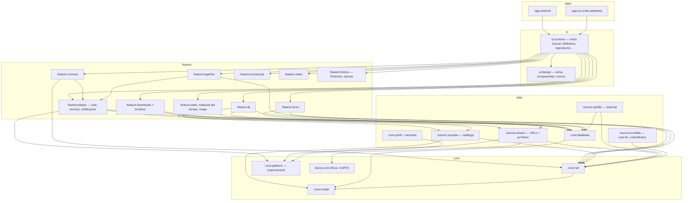
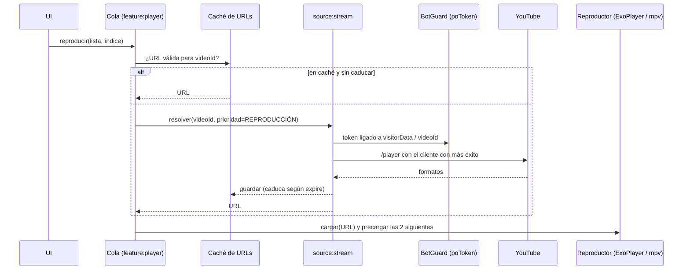
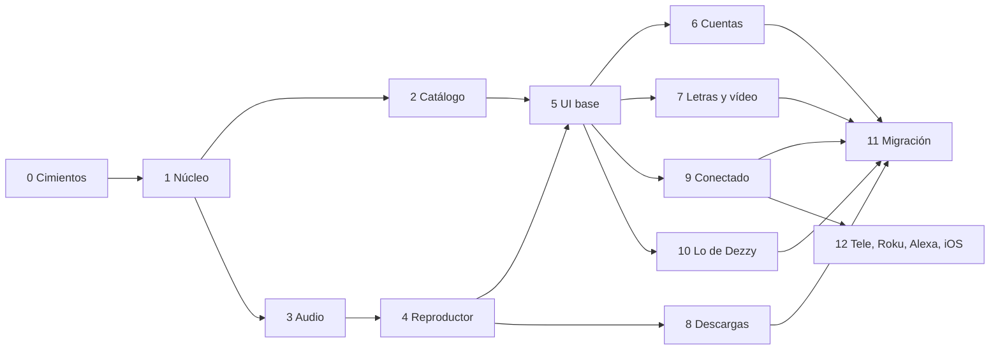

# Dezzy en Kotlin Multiplatform — plan maestro

> Documento de partida para cada sesión que trabaje en la migración. Léelo entero antes de tocar nada.
> Estado: **no empezado** (creado 2026-11-21). Actualiza la tabla de fases al terminar cada una.

## Decisiones tomadas (2026-11-21)

| Tema | Decisión |
|---|---|
| Licencia de la app nueva | **PolyForm Strict 1.0.0** + `TRADEMARKS.md` (mismo esquema que ya tiene Dezzy Desktop desde el commit `5578ebd`) |
| Repo nuevo | `dezzy-music/dezzy-app`, **privado** |
| Escritorio | **Se queda en Electron.** La app KMP es para Android (e iOS más adelante). Escritorio y móvil se entienden por protocolos (Connect, Juntos, Nostr), no por código compartido |
| App Android actual | Sigue en GPL-3.0 con aviso de marca (sección 7e, `TRADEMARKS.md`) hasta que la sustituya la nueva |

## 0. Por qué existe esto

- La app de Android actual (`OpenTune/`) es un **fork de OpenTune bajo GPL-3.0**: 584 commits de Arturo Cervantes y otros, 51 de Dezzy. No se le puede cambiar la licencia, ni cambiando nombres ni reorganizando: sigue siendo obra derivada.
- Objetivo: **una app nueva, desde cero, en Kotlin Multiplatform (Android primero, iOS más adelante; el escritorio sigue en Electron)**, con **licencia propia** desde el primer commit, construida sólo con código de Dezzy y librerías de licencia permisiva.
- Mientras la app nueva no la sustituya, la de Android actual sigue publicándose bajo GPL. Las versiones ya publicadas (hasta 3.0.9) son GPL para siempre.
- Dezzy Desktop (Electron, `antigravity/dezzy-desktop`) es 100 % de Dezzy: es la referencia principal de comportamiento y su código **sí** se puede traducir.

---

## 1. Reglas de sala limpia (obligatorias en cada sesión)

Es lo único que hace que la licencia nueva sea válida. Si una sesión las rompe, ese código hay que tirarlo.

**Se puede abrir y traducir:**
1. `antigravity/dezzy-desktop/` entero (17 commits, todos de Dezzy; dependencias MIT/ISC).
2. Los archivos de [`archivos-propios.txt`](archivos-propios.txt) (124 archivos `.kt` que creó Dezzy), **salvo** las excepciones de §1.1.
3. Los bocetos de `OpenTune/design/*.html` (son de Dezzy).
4. Este documento y los que cuelguen de `docs/migracion-kmp/`.
5. Documentación pública de APIs y protocolos (LRCLIB, Last.fm, Nostr NIPs, Gemini, Media3, Compose…).
6. Librerías con licencia Apache-2.0, MIT, BSD, ISC o LGPL enlazada dinámicamente.

**No se puede abrir mientras se implementa** (ni para «mirar cómo lo hacía»):
- Cualquier archivo de `OpenTune/` que **no** esté en `archivos-propios.txt`: módulos `innertube`, `kugou`, `lrclib`, `lastfm`, `simpmusic`, `betterlyrics`, `kizzy`, `canvas`, `shazamkit`, `artistvideo` y el grueso de `app/`.
- Código de NewPipe / NewPipeExtractor, Metrolist / metroserver, OuterTune, InnerTune, SimpMusic, Echo-Music, ytmdesktop (todos GPL).
- Liner (`.gemini/antigravity/scratch/liner-desktop`), salvo `crates/dezzy-core` (ver §1.1).

**Cómo se trabaja:**
- Lo que hay que hacer se describe por **comportamiento** (§3), nunca pegando código de la app vieja.
- Si una función sólo existe en la parte GPL, se reimplementa a partir de la descripción de §3, de la API pública o de Dezzy Desktop.
- Cada commit dice de dónde sale lo que trae: `Origen: desktop/src/main/connect.ts`, `Origen: propio (archivos-propios: ai/DjTaste.kt)` o `Origen: nuevo`.
- Ante la duda sobre un archivo, **no se usa** y se escribe de nuevo.

### 1.1 Excepciones y cosas a revisar

| Pieza | Situación | Qué hacer |
|---|---|---|
| `connect/LinerConnectManager.kt` | Habla el protocolo de Liner | **No usar.** Connect se hace con el protocolo propio (§3.8) |
| `innertube/.../LibraryContinuationPage.kt`, `PlaylistContinuationPage.kt` | Propios, pero dentro de un módulo GPL y sobre sus tipos | Sólo como referencia de comportamiento |
| `playback/potoken/*` (BotGuard) | Port de NewPipe (GPL) | **No usar.** Rehacer como en el escritorio (`bgutils-js`, MIT) |
| `crates/dezzy-core` (Rust) | Autor Dezzy, GPL-3.0, vive dentro del repo de Liner | Comprobar de dónde salen `cipher.rs` y `potoken.rs`; si son propios, cambiarle la licencia y sacarlo a su propio repo |
| Servidor Listen Together (`antigravity/listen-together`) | GPL y usa el `.proto` de Metrolist (`metroserver`) | Para la app nueva: protocolo propio v3 (§3.9) y servidor nuevo o reescrito |
| `resolver/` (Node, lossless) | De Dezzy; comprobar dependencias | Reutilizable como servicio aparte |
| Canal de Roku (`antigravity/dezzy-roku-channel`) | Imita «fielmente» la interfaz y el verde de Spotify | Cambiar a diseño propio antes de publicarlo |
| `TOGETHER_BEARER_TOKEN` en el APK actual | Secreto del dueño dentro de cada APK | En la app nueva, ningún secreto dentro del binario |

---

## 2. Arquitectura objetivo

### 2.1 Pila técnica

| Capa | Elección | Licencia | Notas |
|---|---|---|---|
| Lenguaje | Kotlin 2.x, KMP | Apache | Objetivos: `androidTarget`, más adelante `iosArm64`. Un `jvm` sólo para pruebas unitarias |
| UI | Compose Multiplatform + Material 3 | Apache | Reutiliza los bocetos de `design/` |
| Navegación | Navigation Compose (KMP) con rutas tipadas | Apache | |
| DI | Koin | Apache | Hilt no es multiplataforma |
| Red | Ktor Client (OkHttp en Android, Darwin en iOS) | Apache | |
| JSON | kotlinx.serialization | Apache | |
| BD | Room KMP (o SQLDelight) | Apache | Esquema nuevo, con importador desde Dezzy 3.x (§4, fase 11) |
| Ajustes | DataStore KMP | Apache | Claves sensibles cifradas (Keystore / DPAPI / Keychain) |
| Imágenes | Coil 3 | Apache | |
| Audio Android | Media3 ExoPlayer + MediaSession | Apache | |
| Audio iOS (más adelante) | AVPlayer vía `expect/actual` | — | El escritorio no entra: sigue en Electron |
| Núcleo nativo | `dezzy-core` (Rust) vía UniFFI, si §1.1 lo permite | propia | Resolver streams/cifrado una sola vez para todas las plataformas |
| Criptografía P2P | Bouncy Castle (`bcprov`) | MIT | Ya se usa en la parte propia de `p2p/` |
| BotGuard / poToken | WebView oculta con el método de `bgutils-js` | MIT | |

### 2.2 Grafo de módulos

### 2.3 Cómo suena una canción (flujo clave)

### 2.4 Lo que va en `commonMain` y lo que no

- **Común:** modelos, clientes HTTP de catálogo/letras/scrobble, BD, ajustes, lógica de cola, DJ (gustos, armado de sesiones), estadísticas, protocolo Connect/Juntos, Nostr, toda la UI.
- **Por plataforma (`expect/actual`):** reproductor y sesión multimedia, servicio en segundo plano, notificaciones, almacén seguro de secretos, descubrimiento en red local (NSD / mDNS), BLE (radar «Cerca», sólo móvil), WebView de BotGuard e inicio de sesión, icono de la app, fondos de pantalla del sistema, widgets.

---

## 3. Qué hace Dezzy (comportamiento, no código)

Lista de funciones que la app nueva tiene que cubrir. Fuente: uso de la app, memoria del proyecto y Dezzy Desktop.

### 3.1 Catálogo (YouTube Music)
- Inicio con estanterías personalizadas, chips de ánimo/género, novedades, rankings por país.
- Búsqueda con sugerencias y filtros (canciones, vídeos, álbumes, artistas, playlists).
- Páginas de álbum, artista (populares, álbumes, sencillos, similares) y playlist con continuaciones (paginación).
- Radio a partir de una canción y «similares».
- **Rankings por país:** el endpoint de charts ignora `gl`; el país se elige con `formData.selectedValues`.

### 3.2 Resolver el audio
- Varios clientes de YouTube ordenados por éxito; timeout ~8 s en reproducción.
- **Las URLs están ligadas a la IP** que las pidió: se resuelve en cada dispositivo; un dispositivo de la misma red puede pasarlas a otro (Connect, teles).
- poToken real con BotGuard: token de streaming ligado a `visitorData` (se genera antes que nada) y token por vídeo ligado a `videoId`. Un token falso hace que **todos** los clientes fallen con «confirma que no eres un bot».
- Ráfagas de `/player` con cookie (descargas en paralelo + precarga) disparan la detección de bots. Prioridades: reproducción > precarga > descargas (máx. 2 resoluciones simultáneas para las dos últimas, con pausas y sin cookie).
- Caché de URLs persistente; deduplicar resoluciones en vuelo; pre-resolver las 2 siguientes.
- El User-Agent de la descarga tiene que ser el del cliente que pidió la URL.

### 3.3 Reproductor
- Cola con orden, aleatorio, repetir, «reproducir a continuación», añadir al final, deshacer.
- Fundido entre canciones (crossfade) sin que la notificación se quede con la canción anterior.
- Ecualizador propio (biquads, ajustes predefinidos) — `audio/DezzyEqManager.kt` y `DezzyBiquadAudioProcessor.kt` son propios.
- Temporizador de apagado, velocidad/tono, normalización.
- 4 estilos de reproductor + visualizadores Cordillera / Túnel / Espejo (bocetos aprobados en `design/`).
- Canvas (vídeo corto de fondo) y modo vídeo (videoclip).
- Burbuja flotante y pantalla siempre encendida (Android).
- Notificación / controles del sistema / pantalla de bloqueo.

### 3.4 Vídeo
- Cliente VISIONOS + `visitorData` → `hlsManifestUrl`, sin poToken; HLS primero y progresivo de respaldo; caché de 256 MB.
- Si la canción es un «Art Track» (« - Topic»), buscar el videoclip real puntuando resultados.
- «Canción» gana aunque el videoclip aún se esté resolviendo.

### 3.5 Letras
- Fuentes públicas (LRCLIB y otras con API pública); letras sincronizadas por línea y por palabra.
- LRCLIB a veces devuelve `duration: null`: no romper la búsqueda.
- Traducción por IA con la clave del usuario.
- Tarjetas para compartir letras.

### 3.6 Biblioteca y cuentas
- Me gusta, playlists propias, historial, descargas, artistas seguidos.
- Inicio de sesión con YouTube (cookie por WebView) y Spotify (cookie `sp_dc`). **Nunca** se borra una sesión por un fallo pasajero: reintentos con espera creciente (15 s, 1 min, 5 min, 15 min) y sólo se pide volver a entrar tras ≥3 rechazos en ≥20 min.
- Copia de seguridad atómica de las sesiones; si los ajustes se corrompen, se recuperan.
- Importar biblioteca de Spotify y precarga (`spotify/SpotifyLibrarySync.kt` es propio).
- «Mods»: cambiar título y carátula de cualquier canción, de forma reversible.
- Copia de seguridad y restauración de toda la biblioteca.

### 3.7 Descargas y lossless
- Descargas con cola, reintentos y exportación a carpeta del usuario.
- Lossless: el `resolver/` propio (Node) busca por ISRC en Deezer (principal) y Qobuz (opcional, con token del usuario) y descifra al vuelo. Es un servicio aparte; la app sólo lo llama.

### 3.8 Dezzy Connect (protocolo propio)
- Hasta 4 dispositivos en estrella: el centro decide, los demás mandan órdenes (`cmd`) y gana la última.
- «Quién puede controlar»: todos o sólo este (`ctl: all|one`); aviso corto «X cambió de canción».
- Operaciones: `take` (con `offset`), `playTrack`, `sync`, estado de la reproducción (`queue`, `index`, `pos`, `playing`, `at` = reloj en el que valía `pos`, `vol`).
- Modos: «sólo allí» o «en ambos» (sincronizado).
- Vinculación por QR con una clave de grupo de 32 bytes; descubrimiento en red local y respaldo por relé.
- La biblioteca sólo se comparte con controladores de confianza.
- Referencia: `dezzy-desktop/src/shared/connect.ts` y `src/main/connect.ts` (traducibles).

### 3.9 Escuchar juntos
- Salas con código, anfitrión, invitados, chat, votos, panel del anfitrión con la posición real de cada oyente.
- Sincronía con reloj compartido; sin eco al emisor; play/pausa idempotentes; cortacircuitos ante tormentas de play/pausa.
- Al unirse o reconectar, el estado se aplica sobre la sala actual (el `SYNC_STATE` no trae el código de sala).
- La app nueva usa **protocolo propio v3** (no el `.proto` de Metrolist).

### 3.10 Social P2P (sin servidor)
- Identidad = 12 palabras BIP-39 → clave NIP-06; nada en servidores propios.
- Relés Nostr públicos; firmas BIP-340; cifrado NIP-44 v2; privados por NIP-17/59 (gift wrap).
- Cuentas privadas (posts envueltos para cada seguidor aprobado), seguir/aprobar/rechazar, comentarios, reacciones.
- «Escuchando ahora» = NIP-38 kind 30315 `d=music`.
- Radar «Cerca» por BLE (UUIDs de service data 0xD22E / 0xD22F, dos mitades de la clave pública).
- El código de `p2p/` (crypto, nostr, P2PSocial, Messaging, Presence, Nearby, Identity, Map…) es propio: se puede llevar casi tal cual a `commonMain` (lo de BLE, a `androidMain`).

### 3.11 DJ Dezzy
- Perfil de gustos: historial de 1 año con vida media de 30 días, franja horaria ±2 h, me gusta, saltos (un salto = menos de 3 s), tasa de exploración.
- Tipos de elección: favoritas, «throwback», novedades de tus artistas, descubrimiento, peticiones; cada elección lleva un `reason` que va al guion.
- Se adapta en vivo a los saltos y no se repite.
- Guion con Gemini y voz (gratis / ElevenLabs / OpenAI) **con la clave de cada usuario** (BYOK); sin clave, frases fijas.
- `ai/DjTaste.kt`, `ai/DjSetBuilder.kt`, `ai/DjVoice.kt`, `ai/GeminiDjClient.kt` son propios.

### 3.12 Estadísticas y descubrimiento
- Estadísticas, racha, minutos de hoy, «Tu año en música», Máquina del tiempo, ADN de la canción.
- Ojo: las marcas de tiempo del historial se guardan como hora local tratada como UTC.
- Mapa musical: rankings por país con caché local de 6 h y ubicación aproximada a 2 decimales.
- Inicio «Dezzy»: saludo + racha, «Sigue donde ibas» con canvas, mixes por género.
- Reconocer canciones (tipo Shazam): el módulo actual es GPL → buscar una alternativa con licencia permisiva o rehacerlo.

### 3.13 Personalización
- Temas y paletas, creador de temas, colores dinámicos.
- Icono de la app: «d·play» (predeterminado) y «Estrella», 8 paletas en el launcher (16 alias) y colores libres dentro de la app (`appicon/` es propio).
- Fondo de la app con imagen o vídeo, versión vertical y horizontal; desde un pin de Pinterest con detección de orientación (`utils/PinterestWallpaper.kt` es propio).

### 3.14 Integraciones
- Discord Rich Presence (el módulo `kizzy` es GPL → rehacer a partir de la documentación pública de Discord).
- Last.fm y ListenBrainz (APIs públicas).
- Cast / Chromecast con receptor propio (`OpenTune/cast-receiver`), DLNA.
- Vinculación con el escritorio por QR.
- Actualizador propio: release de GitHub con etiqueta sin «v» (`3.0.9`), título «Dezzy X.Y.Z» y el APK como **primer** adjunto.

---

## 4. Fases

Cada fase termina con: compila en Android, se ha probado en marcha (emulador o dispositivo), commit propio sin firma de Claude y esta tabla actualizada.

| # | Fase | Entregable | Depende de | Estado |
|---|---|---|---|---|
| 0 | Cimientos | Repo nuevo con licencia, plantilla KMP, CI, «hola» en Android | — | pendiente |
| 1 | Núcleo | `core:model`, `core:net`, `core:database`, `core:prefs`, Koin | 0 | pendiente |
| 2 | Catálogo | `source:youtube`: inicio, búsqueda, álbum, artista, playlist | 1 | pendiente |
| 3 | Audio | `source:stream` + poToken + caché de URLs + prioridades | 1 | pendiente |
| 4 | Reproductor | `feature:player` con servicio, notificación y controles del sistema | 3 | pendiente |
| 5 | UI base | Tema, navegación, inicio, buscar, biblioteca, reproductor (1 estilo) | 2, 4 | pendiente |
| 6 | Cuentas | Inicio de sesión con YouTube y Spotify, sesiones a prueba de fallos, importar Spotify | 5 | pendiente |
| 7 | Letras y vídeo | Letras sincronizadas, traducción, modo vídeo, canvas | 5 | pendiente |
| 8 | Descargas | Cola de descargas, exportar, lossless | 4 | pendiente |
| 9 | Conectado | Connect, Escuchar juntos (v3), Social P2P | 4, 5 | pendiente |
| 10 | Lo de Dezzy | DJ, estadísticas, máquina del tiempo, mapa, mods, 4 estilos + visualizadores, icono, fondos | 5 | pendiente |
| 11 | Migración | Importador desde Dezzy 3.x, mismo `applicationId` y misma firma | todo | pendiente |
| 12 | Más allá | Tele web, Android TV, Roku, Alexa, iOS | 9 | pendiente |

### Fase 0 — Cimientos
1. Crear el repo privado `dezzy-music/dezzy-app` (decidido).
2. Crear el proyecto con el asistente KMP (Compose Multiplatform, objetivo Android; iOS se añade después). Paquete `com.dezzy.app` en el código; `applicationId` final `com.dezzy.music` (fase 11).
3. `LICENSE.md` (PolyForm Strict 1.0.0 con «Required Notice»; copiar el de `dezzy-desktop`), `TRADEMARKS.md`, `docs/sala-limpia.md` (copia de §1), cabecera de licencia en cada archivo.
4. GitHub Actions gratis: compilar Android (debug) y pasar las pruebas JVM en cada push.
5. `graphify` en el repo nuevo y un `CLAUDE.md` que remita a este plan.
- **Hecho cuando:** la app abre una pantalla «Dezzy» en el móvil.

### Fase 1 — Núcleo
- Modelos (`Track`, `Album`, `Artist`, `Playlist`, `QueueItem`, `Lyrics`…), cliente Ktor con reintentos y User-Agent configurable, BD con tablas de canciones/álbumes/artistas/playlists/historial/me gusta, ajustes con DataStore y almacén seguro por plataforma.
- **Hecho cuando:** pruebas unitarias de BD y ajustes pasan en JVM.

### Fase 2 — Catálogo
- Cliente propio del API web de YouTube Music escrito a partir de las peticiones que hace la propia web (DevTools) y de `youtubei.js` (MIT) como referencia, **no** del módulo `innertube`.
- Parsers de estanterías, búsqueda, álbum, artista, playlist y continuaciones; rankings con `formData.selectedValues`.
- **Hecho cuando:** pruebas contra la red real devuelven inicio, búsqueda y un álbum.

### Fase 3 — Audio
- Opción A: `dezzy-core` vía UniFFI (si §1.1 queda limpio). Opción B: Kotlin puro en `commonMain`.
- BotGuard: WebView oculta en Android; mismo método que `dezzy-desktop/src/main/potoken.ts` (traducible).
- Caché de URLs, deduplicación, prioridades y presupuesto de ráfagas (§3.2).
- **Hecho cuando:** 20 canciones seguidas se resuelven sin «no eres un bot» en el móvil.

### Fase 4 — Reproductor
- Android: `MediaSessionService` + ExoPlayer (iOS más adelante: AVPlayer).
- Cola común en `commonMain`; precarga de las 2 siguientes; crossfade; ecualizador propio.
- **Hecho cuando:** se oye, se pausa desde la notificación y la pantalla de bloqueo, y la cola avanza sola.

### Fase 5 — UI base
- Antes de cada pantalla: **3 bocetos HTML (A/B/C) en `design/`, abrirlos en Chrome y esperar la elección** (regla del usuario). Se pueden reutilizar los ya aprobados.
- Inicio, Buscar, Biblioteca, Álbum/Artista/Playlist, reproductor completo y mini, ajustes básicos. Edge-to-edge en Android.

### Fases 6 a 10
- Siguen §3 punto por punto. Para cada función: leer su apartado en §3, buscar si hay versión propia (`archivos-propios.txt` o `dezzy-desktop`) y traducirla; si no, escribirla de nuevo.

### Fase 11 — Migración
- Mismo `applicationId` (`com.dezzy.music`) y misma clave de firma (`app/keystore/release.keystore`) para que el actualizador y Play lo traten como una actualización.
- La BD nueva no es compatible: al primer arranque, importar desde la copia de seguridad de Dezzy 3.x (o leer la BD vieja con un lector propio, sin código GPL).
- Publicar como `4.0.0` siguiendo el formato del actualizador (§3.14).

### Fase 12 — Más allá
- Plan de plataformas: receptor web para cualquier tele, DLNA, Cast, Android TV/Fire TV, Roku (`antigravity/dezzy-roku-channel`), Alexa (`antigravity/dezzy-alexa-skill`), iOS.
- Ojo con las tiendas: el contenido de YouTube sin licencia hace probable el rechazo; publicar receptores «vacíos» y repartir lo demás por canales propios.

---

## 5. Cómo empezar una sesión de migración

1. Leer este archivo y `docs/migracion-kmp/archivos-propios.txt`.
2. Ver en la tabla de §4 la primera fase «pendiente» o «en curso».
3. Para cada pieza: §3 (qué hace) → ¿hay versión propia? → traducir o escribir de nuevo → indicar el origen en el commit.
4. Compilar Android y probarlo en marcha (y, si toca Connect o Juntos, contra Dezzy Desktop).
5. Actualizar la tabla de §4 y, si se aprendió algo que no está en el código, apuntarlo en §6.

## 6. Trampas conocidas
- URLs de audio ligadas a la IP; poToken ligado a `visitorData` y `videoId`.
- Las ráfagas de `/player` con cookie provocan la detección de bots.
- No tratar un fallo pasajero del Keystore o de Spotify como cierre de sesión.
- Los charts ignoran `gl`.
- Las marcas de tiempo del historial son hora local guardada como UTC.
- La notificación se quedaba en la canción anterior al hacer crossfade: el metadato debe seguir a la canción que suena, no a la que se carga.
- Prefetch con índice −1 rompía la cola: validar índices siempre.
- Ningún secreto del dueño dentro del binario: todo lo de pago lo pone el usuario (BYOK).
- Commits y PR **sin** firma de Claude.
